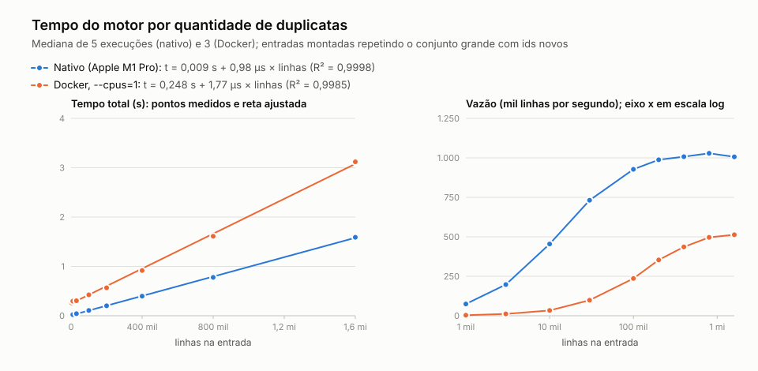

# Motor de regras de duplicatas escriturais

Hackathon Ideen 2026, desafio 1 ([enunciado](hackathon-2026-d1-kit/ENUNCIADO.md)).

## O problema

Classificar cada linha de um arquivo JSON Lines pela primeira regra de negócio que ela satisfaz,
com as regras fora do código, acertando os casos de borda e terminando o mais rápido possível.

## O que fiz

Um motor genérico em Rust. Tudo o que é de duplicata (campos, tipos, regras, data de referência)
fica num arquivo YAML que o motor lê na partida.

```
regras/regras.yaml ──(na partida, 0,1 ms)──▶ árvore de condições + lista dos 16 campos usados
                                                          │
entrada.jsonl ──▶ para cada linha: valida o JSON inteiro, ─┴─▶ avalia as regras ──▶ id:7 - regra: R05
                  guardando só os 16 campos                    em ordem; vale a
                                                               primeira satisfeita
```

### As regras

As condições usam a notação da tabela do enunciado. O arquivo é gerado do próprio `ENUNCIADO.md`
por [ferramentas/extrair_regras.py](ferramentas/extrair_regras.py) e depois pode ser editado à
mão:

```yaml
campos:
  financeiro.valor: numero
  sacado.segmento: texto
  ...
regras:
  - codigo: R07
    categoria: Alto valor
    quando: financeiro.valor ≥ 500000 OU (sacado.segmento = AGRO E financeiro.valor ≥ 200000)
```

| Na condição | Significa |
|---|---|
| `E`, `OU`, `NÃO`, `( )` | lógica; `E` antes de `OU` |
| `=` `≠` `<` `≤` `>` `≥` | comparação (também `!=` `<=` `>=`) |
| `é A, B ou C` | pertence à lista |
| `está vazio` · `começa com X` · `é verdadeiro` · `é falso` | os demais operadores do enunciado |

Uma palavra declarada em `campos:` é campo, uma declarada em `constantes:` é constante, o resto é
literal. O tipo vem do campo: `fiscal.cfop começa com 5` compara texto, `financeiro.valor ≥
100000` compara número. Regra mal escrita impede o motor de subir, com a mensagem apontando a
regra (`regra R06: campo não declarado: financeiro.valr`).

### O motor

Quatro arquivos em [motor/src/](motor/src/): `manifesto.rs` (YAML e linguagem das regras),
`json.rs` (parser), `motor.rs` (avaliação e saída), `valor.rs` (tipos e comparações).

### Como garanti os acertos

Os conjuntos do kit não têm nenhum caso da seção "Semântica" do enunciado: todo campo existe e tem
o tipo certo. Para a surpresa, que é feita de bordas, montei três peças:

- [testes/oraculo.py](testes/oraculo.py): uma implementação lenta e literal das regras, escrita
  direto do enunciado. Não lê o YAML, então também confere a tradução das regras.
- [testes/gerar_bordas.py](testes/gerar_bordas.py): gera 269 mil linhas a partir dos registros do
  kit, com campo ausente, nulo, tipo trocado, maiúscula, escape `\u0041TIVA`, data inválida, valor
  no limite (`100000`, `99999.99`, `1e5`), objeto pai nulo, chave repetida, JSON quebrado e
  combinações de várias regras ao mesmo tempo (todos os pares de regras que podem disparar juntos
  aparecem).
- O motor e o oráculo comparados linha a linha, inclusive em "quais regras cada linha satisfaz".

### Velocidade

Só entrou otimização que se explica em uma frase. O parser valida a linha inteira (JSON inválido
é `SEM_REGRA`), mas só converte e guarda os campos que as regras usam. Strings são varridas 8 bytes
por vez, chaves são comparadas pelos 8 primeiros bytes como um inteiro, e o arquivo de entrada é
mapeado em memória. Cada mudança entrou só depois de medida no Docker com 1 CPU; uma thread de
leitura em paralelo foi medida, não ganhou nada e saiu.

A imagem é compilada com PGO (*profile-guided optimization*): o motor é compilado instrumentado,
roda uma vez sobre o conjunto pequeno repetido 2.000 vezes e é recompilado sabendo quais caminhos
do código são os quentes. Isso corta ~15% do CPU do motor (0,18 s para 0,155 s no grande, dentro
do container). O PGO muda só a organização do código de máquina: nenhum literal das regras entra
no binário, e o `testes/rodar.sh --docker` confere, com o binário da imagem, as bordas, as regras
em ordem inversa e o segundo domínio, todos sem recompilar.

## Como reproduzir

Precisa de Docker. Para rodar fora do Docker e os testes: Rust 1.85 ou mais novo e Python 3.

```bash
# como a banca roda
docker build -t motor-regras .
python3 hackathon-2026-d1-kit/medir.py --set grande \
  --cmd "docker run --rm --cpus=1 -v {dir}:/dados motor-regras --entrada /dados/{arquivo}"

# sem Docker
cd motor && cargo build --release && cd ..
motor/target/release/motor --entrada hackathon-2026-d1-kit/dados/pequeno/entrada.jsonl

# todos os testes (a primeira vez gera as bordas, ~30 s); --docker inclui a imagem
testes/rodar.sh --docker
```

Opções do motor: `--regras outro.yaml` usa outro manifesto (padrão: `regras/regras.yaml`, que já
está dentro da imagem); `--todas` lista todas as regras que a linha satisfaz, em ordem
(`id:17 - regra: T01,T07`; a primeira é a classificação).

O segundo domínio roda com o mesmo binário: [dominios/pedidos/](dominios/pedidos/) é uma triagem
de pedidos de e-commerce com sete regras, outro campo de id, outras constantes e um gabarito
escrito à mão.

```bash
docker run --rm -v "$PWD/dominios/pedidos:/d" motor-regras --regras /d/regras.yaml --entrada /d/entrada.jsonl
```

## Evidências

Em [evidencias/](evidencias/), saída do `medir.py` com o comando da banca (Docker, `--cpus=1`, três
execuções), num Apple M1 Pro com Docker Desktop:

| Conjunto | Acertos | Mediana |
|---|---|---|
| pequeno | 100 de 100 | 0,268 s |
| grande | 200.000 de 200.000 | 0,636 s |
| bordas geradas | 269.692 de 269.692 | 0,729 s |
| grande, no OrbStack | 200.000 de 200.000 | 0,613 s |

No grande, uns 0,27 s são do próprio `docker run` (subir e derrubar o container); o mesmo comando
sem Docker leva 0,22 s, e o oráculo em Python, 3,2 s. A mediana de três execuções no Docker varia
uns 30 ms de uma rodada para outra, o mesmo tamanho do ganho do PGO no grande; por isso o efeito
dele aparece melhor nas entradas maiores do gráfico abaixo.

### Como o tempo cresce com o número de linhas

<picture>
  <source media="(prefers-color-scheme: dark)" srcset="evidencias/escala-escuro.svg">
  
</picture>

O tempo cresce em linha reta, de mil a 1,6 milhão de linhas (8 vezes o conjunto grande):
0,010 s + 0,97 µs por linha no nativo (R² = 0,99998) e 0,273 s + 1,54 µs por linha no Docker
(R² = 0,9998). A vazão sobe nas entradas pequenas porque o custo fixo (subir o processo e, no
Docker, o container) se dilui, e se estabiliza perto de 1 milhão de linhas por segundo no nativo.
O binário do Docker é o da imagem, com PGO; o nativo é o build comum do `cargo`, sem PGO. Antes do
PGO, a reta do Docker era 1,77 µs por linha, e 1,6 milhão de linhas levavam 3,12 s; com ele,
2,72 s. Números em [evidencias/escala.csv](evidencias/escala.csv); para refazer,
`python3 testes/escala.py`.

O `testes/rodar.sh` confere, além disso: a árvore em que cada regra do YAML compila, os casos
manuais, UTF-8 inválido, `--todas` contra o oráculo, as regras em ordem inversa (cada linha passa a
ser da última regra que satisfazia, sem recompilar), o segundo domínio e a recusa de regra mal
escrita.

## Decisões onde o enunciado deixa espaço

Onde o enunciado não fixa o comportamento, o motor segue o `json` do Python, na aposta de que o
gabarito da banca sai de Python, como o `medir.py`:

- chave repetida: vale a última; objeto pai repetido é substituído inteiro, sem mesclar;
- objeto pai nulo, ausente ou que não é objeto: os campos de dentro contam como ausentes, e
  `manifestacao.tipo está vazio` é verdadeiro;
- `1e5` e `100000` são números; `true` não é; precisão de `double`;
- texto vazio é texto: `"" ≠ "SP"` é verdadeiro;
- escapes são decodificados antes de comparar (`"\u0041TIVA"` é `ATIVA`), em chaves e valores;
- data só vale `AAAA-MM-DD` com dígitos ASCII e dia que existe (`2026-02-30` é ausente);
- `NaN` e `Infinity` são aceitos como no Python;
- linha com JSON inválido sai como `SEM_REGRA`, desde que dê para achar o id; o id é ecoado como
  veio na entrada.

Dois limites conhecidos, em casos extremos: o motor recusa aninhamento acima de 900 níveis
(o Python desiste perto de mil) e aceita inteiros com mais de 4.300 dígitos (o Python recusa).

## Onde a IA acelerou e onde errou

O trabalho foi feito em par com o Claude Code. O registro completo, item a item, está em
[NOTAS-IA.md](NOTAS-IA.md).

A IA acelerou o levantamento dos dados antes de escrever código (foi o que mostrou que o kit não
tinha bordas), o oráculo, o gerador e o motor, que acertou tudo na primeira execução.

Onde errou, e como foi corrigido:

- **Projetou o motor sem dizer como ler a entrada.** Apontei a leitura em stream; a medição
  confirmou menos memória e menos tempo. Mais tarde o `mmap` mediu ~6% a menos no Docker e passou a
  ser o padrão; a leitura em blocos ficou para entrada por pipe.
- **Defendeu Rust com um argumento que a medição desmentiu em parte.** Num laço simples, o Go foi
  mais rápido; no padrão real do parser, o Rust foi 1,7 vez mais rápido. A escolha ficou, pelo
  motivo medido.
- **Otimizou no chute antes de usar o profiler**, e uma das trocas piorou o tempo (215 para 238
  ms) antes de melhorar. Daí em diante, toda mudança foi medida e o que não ganhou saiu.
- **Escreveu o Dockerfile sem o `musl-dev`**, e o primeiro build falhou.
- **Colocou bytes UTF-8 inválidos no arquivo principal de bordas**, o que quebrou o `medir.py`. O
  achado ficou: o `medir.py` lê a entrada como texto, então, se a banca usar esse script, a
  surpresa não terá UTF-8 inválido.
- **Escreveu um teste com a lógica invertida**, que acusou falha com o motor certo; a mensagem do
  próprio motor no relatório mostrou o erro.

## Estrutura

| Caminho | O que é |
|---|---|
| `hackathon-2026-d1-kit/` | kit do desafio, intocado: enunciado, apresentação, `medir.py` e dados |
| `regras/regras.yaml` | as regras |
| `motor/` | o motor (Rust) e o teste da linguagem das regras |
| `Dockerfile` | build estático com PGO e imagem `scratch` com o binário e as regras (0,8 MB) |
| `testes/` | oráculo, gerador de bordas, casos manuais, `rodar.sh`, `escala.py` (medição de escala) |
| `dominios/pedidos/` | segundo domínio |
| `ferramentas/extrair_regras.py` | gera o `regras.yaml` a partir do enunciado |
| `evidencias/` | saídas do `medir.py`, a máquina usada e a medição de escala (CSV e gráfico) |
| `NOTAS-IA.md` | onde a IA acelerou e onde errou, item a item |
